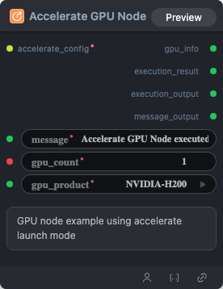

# Accelerate GPU Node 节点

  

## {{section}} 功能概述

GPU node example using accelerate launch mode

## {{section}} 输入类型

| 参数 | 数据类型 | 必填 | 描述 |
|------|---------|------|------|
| message | STRING | 是 | 字符串。默认值：`Accelerate GPU Node executed successfully` |
| accelerate_config | ACCELERATE_CONFIG | 是 | Accelerate 配置 YAML。默认值：- |
| gpu_count | INT | 是 | 整数。默认值：`1` |
| gpu_product | STRING | 是 | 字符串。默认值：`NVIDIA-H100-NVL` Options: NVIDIA-H100-NVL, NVIDIA-L40S, NVIDIA-H200, NVIDIA-B200, NVIDIA-H100-80GB-HBM3 |
## {{section}} 输出类型

| 参数 | 数据类型 | 描述 |
|------|---------|------|
| gpu_info | STRING | 字符串 |
| execution_result | STRING | 字符串 |
| execution_output | STRING | 字符串 |
| message_output | STRING | 字符串 |

## {{section}} Workflow JSON 定义

完整 workflow 定义见 [`workflow/AccelerateGpuNode/AccelerateGpuNode.json`](../../workflow/AccelerateGpuNode/AccelerateGpuNode.json)。

## {{section}} 运行 Workflow

```bash
export PYROMIND_API_KEY=<your-api-key>
python -m pyromind_sdk.test_run_workflow_cli workflow/AccelerateGpuNode/AccelerateGpuNode.json [options]
```

| 选项 | 默认值 | 说明 |
|------|--------|------|
| `--name` | `accelerateGpuNode` | 任务名称 |
| `--output` | - | 输出结果文件 |
| `--poll-interval` | 5 | 轮询间隔（秒） |
| `--timeout` | 600 | 最大等待时间（秒） |
| `--pretty` | false | 美化 JSON 输出 |
| `--max-retries` | 0 | API 请求最大重试次数 |
| `-h, --help` | - | 显示帮助信息 |
