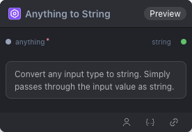

# Anything to String 节点

  

## {{section}} 功能概述

任意类型转字符串节点：将任何类型的输入转换为字符串输出
    这是一个通用的转换节点，用于将 MODEL、STRING 等类型转换为 STRING

## {{section}} 输入类型

| 参数 | 数据类型 | 必填 | 描述 |
|------|---------|------|------|
| anything | * | 是 | 任意类型。默认值：- |
## {{section}} 输出类型

| 参数 | 数据类型 | 描述 |
|------|---------|------|
| string | STRING | 字符串 |

## {{section}} Workflow JSON 定义

完整 workflow 定义见 [`workflow/AnythingToString/AnythingToString.json`](../../workflow/AnythingToString/AnythingToString.json)。

## {{section}} 运行 Workflow

```bash
export PYROMIND_API_KEY=<your-api-key>
python -m pyromind_sdk.test_run_workflow_cli workflow/AnythingToString/AnythingToString.json [options]
```

| 选项 | 默认值 | 说明 |
|------|--------|------|
| `--name` | `anythingToString` | 任务名称 |
| `--output` | - | 输出结果文件 |
| `--poll-interval` | 5 | 轮询间隔（秒） |
| `--timeout` | 600 | 最大等待时间（秒） |
| `--pretty` | false | 美化 JSON 输出 |
| `--max-retries` | 0 | API 请求最大重试次数 |
| `-h, --help` | - | 显示帮助信息 |
