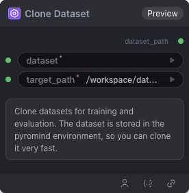

# Clone Dataset 节点

  

## {{section}} 功能概述

克隆数据集

## {{section}} 输入类型

| 参数 | 数据类型 | 必填 | 描述 |
|------|---------|------|------|
| dataset | STRING | 是 | 字符串。默认值：- Options: OpenGVLab/ScaleCUA-Data, Writer/omniact, agibot-world/AgiBotWorld-Alpha-327, agibot-world/AgiBotWorld-Alpha-327-Extract, agibot-world/AgiBotWorld-Alpha-CtrlWorld-327, agibot-world/AgiBotWorld-Alpha-Lerobot-327, agibot-world/AgiBotWorld-Alpha-Openpi-327, cadene/droid_1.0.1, gui-360/gui-excel, gui-360/processed_data, henryhe0123/PC-Agent-E, openai/gsm8k, ritzzai/GUI-R1, xlangai/aguvis-stage1, xlangai/aguvis-stage2, zonghanHZH/UGround-V1-8k |
| target_path | STRING | 是 | 字符串。默认值：`/workspace/datasets/` Options: /workspace/datasets/ |
## {{section}} 输出类型

| 参数 | 数据类型 | 描述 |
|------|---------|------|
| dataset_path | STRING | 字符串 |

## {{section}} Workflow JSON 定义

完整 workflow 定义见 [`workflow/CloneAndCacheDataset/CloneAndCacheDataset.json`](../../workflow/CloneAndCacheDataset/CloneAndCacheDataset.json)。

## {{section}} 运行 Workflow

```bash
export PYROMIND_API_KEY=<your-api-key>
python -m pyromind_sdk.test_run_workflow_cli workflow/CloneAndCacheDataset/CloneAndCacheDataset.json [options]
```

| 选项 | 默认值 | 说明 |
|------|--------|------|
| `--name` | `cloneAndCacheDataset` | 任务名称 |
| `--output` | - | 输出结果文件 |
| `--poll-interval` | 5 | 轮询间隔（秒） |
| `--timeout` | 600 | 最大等待时间（秒） |
| `--pretty` | false | 美化 JSON 输出 |
| `--max-retries` | 0 | API 请求最大重试次数 |
| `-h, --help` | - | 显示帮助信息 |
