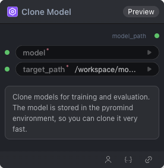

# Clone Model 节点

  

## {{section}} 功能概述

克隆模型

## {{section}} 输入类型

| 参数 | 数据类型 | 必填 | 描述 |
|------|---------|------|------|
| model | STRING | 是 | 字符串。默认值：- Options: Qwen/Qwen3-0.6B, Qwen/Qwen3-1.7B, Qwen/Qwen3-14B, Qwen/Qwen3-235B-A22B-FP8, Qwen/Qwen3-32B, Qwen/Qwen3-32B-FP8, Qwen/Qwen3-4B, Qwen/Qwen3-8B, Qwen/Qwen3-VL-235B-A22B-Instruct, Qwen/Qwen3-VL-32B-Instruct, Qwen/Qwen3-VL-4B-Instruct, openai/clip-vit-base-patch32, openpi/big_vision, openpi/pi05_base, pretrained/gui-ck900-lora, stabilityai/stable-video-diffusion-img2vid |
| target_path | STRING | 是 | 字符串。默认值：`/workspace/models/` Options: /workspace/models/ |
## {{section}} 输出类型

| 参数 | 数据类型 | 描述 |
|------|---------|------|
| model_path | MODEL | 模型引用 |

## {{section}} Workflow JSON 定义

完整 workflow 定义见 [`workflow/CloneAndCacheModel/CloneAndCacheModel.json`](../../workflow/CloneAndCacheModel/CloneAndCacheModel.json)。

## {{section}} 运行 Workflow

```bash
export PYROMIND_API_KEY=<your-api-key>
python -m pyromind_sdk.test_run_workflow_cli workflow/CloneAndCacheModel/CloneAndCacheModel.json [options]
```

| 选项 | 默认值 | 说明 |
|------|--------|------|
| `--name` | `cloneAndCacheModel` | 任务名称 |
| `--output` | - | 输出结果文件 |
| `--poll-interval` | 5 | 轮询间隔（秒） |
| `--timeout` | 600 | 最大等待时间（秒） |
| `--pretty` | false | 美化 JSON 输出 |
| `--max-retries` | 0 | API 请求最大重试次数 |
| `-h, --help` | - | 显示帮助信息 |
