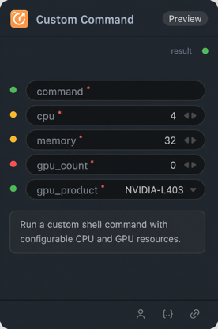

# Custom Command 节点

## 1.1 功能概述

使用可配置的 CPU、内存和 GPU 资源执行自定义 shell 命令，并将命令输出作为字符串返回。

## 1.2 输入类型

| 参数 | 数据类型 | 必填 | 描述 |
|------|---------|------|------|
| command | STRING | 是 | 要执行的 shell 命令。默认值为两行：`echo "hello from custom command"` 和 `echo "param=[$param]"` |
| cpu | INT | 是 | CPU 核数限制（1–64）。默认值：4 |
| memory | INT | 是 | 内存限制，单位 GiB（1–256）。默认值：32 |
| gpu_count | INT | 是 | 要申请的 GPU 数量（1–8）。默认值：1 |
| gpu_product | STRING | 是 | gpu_count 大于零时要申请的 GPU 产品型号。枚举：NVIDIA-H200、NVIDIA-H100-80GB-HBM3。（以部署环境实际可用显卡为准） |
| param | STRING | 否 | 传递给 shell 命令的可选参数，命令中通过 `$param` 引用。默认值：param-value |

## 1.3 输出类型

| 参数 | 数据类型 | 描述 |
|------|---------|------|
| result | STRING | 命令捕获到的标准输出和标准错误。 |

## 1.4 Workflow JSON 定义

基础命令示例见 [workflow/CustomCommandNode/CustomCommandNode.json](../../workflow/CustomCommandNode/CustomCommandNode.json)。[CustomCommandGPUNode workflow](../../workflow/CustomCommandNode/CustomCommandGPUNode.json) 在 `cn-east-1#pre` 申请一张 `NVIDIA-H20` 显卡，并执行 `nvidia-smi --query-gpu=name --format=csv,noheader`；`result` 输出容器实际识别到的显卡型号。本次验证结果为 `NVIDIA H20-3e`。如果目标集群没有该 `gpu_product`，请改为该集群可用的型号。

## 1.5 运行 Workflow

~~~bash
export PYROMIND_API_KEY=<your-api-key>
# 运行显卡型号查询示例
python - <<'PY'
import json
import os
from pathlib import Path
from pyromind_sdk import PyroMindAPIClient
from pyromind_sdk.client.models import TrainingTaskCreateRequest

workflow = json.loads(Path("workflow/CustomCommandNode/CustomCommandGPUNode.json").read_text())
client = PyroMindAPIClient(
    api_key=os.environ["PYROMIND_API_KEY"],
    base_url="https://pre-api-cn-east-1.pyromind-asia.cn/api/v1/",
    cluster="cn-east-1#pre",
)
result = client.studio.create_and_wait(
    TrainingTaskCreateRequest(
        name="custom-gpu-type-check",
        workflow=workflow,
        out_id="custom-gpu-type-check",
    ),
    timeout=300,
    check_interval=3,
    export_node_outputs=True,
)
print(f"状态：{result['status']}")
print(result["nodes"][0]["output"]["result"])
PY
~~~
