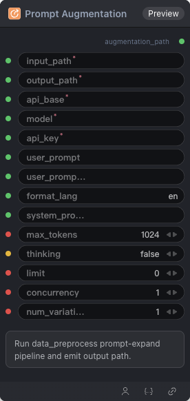

# Prompt Augmentation 节点



## 1.1 功能概述

运行 data_preprocess prompt-expand 流水线并输出增强后的数据路径。

## 1.2 输入类型

| 参数 | 数据类型 | 必填 | 描述 |
|------|---------|------|------|
| input_path | STRING | 是 | - |
| output_path | STRING | 是 | 输出目录路径 |
| api_base | STRING | 是 | - |
| model | STRING | 是 | - |
| api_key | STRING | 是 | - |
| user_prompt | STRING | 否 | - |
| user_prompt_column | STRING | 否 | 默认值：`''` |
| format_lang | STRING | 否 | 默认值：`en` |
| system_prompt | STRING | 否 | 默认值：`''` |
| max_tokens | INT | 否 | 默认值：`1024` |
| thinking | BOOLEAN | 否 | 默认值：`false` |
| limit | INT | 否 | 默认值：`0` |
| concurrency | INT | 否 | 默认值：`1` |
| num_variations | INT | 否 | 默认值：`1` |

## 1.3 输出类型

| 参数 | 数据类型 | 描述 |
|------|---------|------|
| augmentation_path | STRING | 数据增强输出路径 |

## 1.4 Workflow JSON 定义

完整 workflow 定义见 [`workflow/DataPreprocessPromptExpandNode/DataPreprocessPromptExpandNode.json`](../../workflow/DataPreprocessPromptExpandNode/DataPreprocessPromptExpandNode.json)。

## 1.5 运行 Workflow

```bash
export PYROMIND_API_KEY=<your-api-key>
python -m pyromind_sdk.test_run_workflow_cli workflow/DataPreprocessPromptExpandNode/DataPreprocessPromptExpandNode.json [options]
```

| 选项 | 默认值 | 说明 |
|------|--------|------|
| `--name` | `dataPreprocessPromptExpandNode` | 任务名称 |
| `--output` | - | 输出结果文件 |
| `--poll-interval` | 5 | 轮询间隔（秒） |
| `--timeout` | 600 | 最大等待时间（秒） |
| `--pretty` | false | 美化 JSON 输出 |
| `--max-retries` | 0 | API 请求最大重试次数 |
| `-h, --help` | - | 显示帮助信息 |
