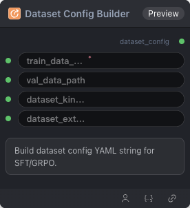

# Dataset Config Builder 节点



## 1.1 功能概述

构建用于 SFT/GRPO/DPO 训练的数据集配置 YAML 字符串。组合数据路径、dataset_kind_config 与 dataset_extra_config。

## 1.2 输入类型

| 参数 | 数据类型 | 必填 | 描述 |
|------|---------|------|------|
| train_data_path | STRING | 是 | 训练数据路径 |
| val_data_path | STRING | 否 | 验证数据路径。默认值：`''` |
| dataset_kind_config | STRING | 否 | 数据集 kind 配置 YAML 字符串（来自 Vision/Text/Messages Builder）。默认值：`''` |
| dataset_extra_config | STRING | 否 | 数据集额外配置 YAML 字符串（来自 Dataset Extra Config Builder）。默认值：`''` |

## 1.3 输出类型

| 参数 | 数据类型 | 描述 |
|------|---------|------|
| dataset_config | STRING | 构建的数据集配置 YAML 字符串 |

## 1.4 Workflow JSON 定义

完整 workflow 定义见 [`workflow/DatasetConfigBuilderNode/DatasetConfigBuilderNode.json`](../../workflow/DatasetConfigBuilderNode/DatasetConfigBuilderNode.json)。

示例配置（典型流水线：Vision Kind Builder → Extra Config Builder → Dataset Config Builder）：
```json
{
  "config": {
    "train_data_path": "/workspace/datasets/openai/gsm8k/train.jsonl",
    "val_data_path": "",
    "dataset_kind_config": "dataloader_kind: vision\nimage_field: image_path\nassistant_response_field: gt",
    "dataset_extra_config": "max_seq_length: 4096\nsft_collator_entry: train.sft_collator:make_collate_fn"
  }
}
```

## 1.5 运行 Workflow

```bash
export PYROMIND_API_KEY=<your-api-key>
python -m pyromind_sdk.test_run_workflow_cli workflow/DatasetConfigBuilderNode/DatasetConfigBuilderNode.json [options]
```

| 选项 | 默认值 | 说明 |
|------|--------|------|
| `--name` | `DatasetConfigBuilderNode` | 任务名称 |
| `--output` | - | 输出结果文件 |
| `--poll-interval` | 5 | 轮询间隔（秒） |
| `--timeout` | 600 | 最大等待时间（秒） |
| `--pretty` | false | 美化 JSON 输出 |
| `--max-retries` | 0 | API 请求最大重试次数 |
| `-h, --help` | - | 显示帮助信息 |
