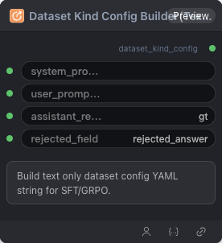

# Dataset Kind Config Builder(Text Only) 节点



## 1.1 功能概述

构建纯文本类型数据集的 kind 配置 YAML 字符串，供 Dataset Config Builder 使用。

## 1.2 输入类型

| 参数 | 数据类型 | 必填 | 描述 |
|------|---------|------|------|
| system_prompt_field | STRING | 否 | 系统提示字段名。默认值：`''` |
| user_prompt_field | STRING | 否 | 用户提示字段名。默认值：`''` |
| assistant_response_field | STRING | 否 | 助手回复字段名。默认值：`gt` |
| rejected_field | STRING | 否 | 拒绝回复字段名（DPO 用）。默认值：`rejected_answer` |

## 1.3 输出类型

| 参数 | 数据类型 | 描述 |
|------|---------|------|
| dataset_kind_config | STRING | 构建的 kind 配置 YAML 字符串 |

## 1.4 Workflow JSON 定义

完整 workflow 定义见 [`workflow/DatasetConfigBuilderTextNode/DatasetConfigBuilderTextNode.json`](../../workflow/DatasetConfigBuilderTextNode/DatasetConfigBuilderTextNode.json)。

## 1.5 运行 Workflow

```bash
export PYROMIND_API_KEY=<your-api-key>
python -m pyromind_sdk.test_run_workflow_cli workflow/DatasetConfigBuilderTextNode/DatasetConfigBuilderTextNode.json [options]
```

| 选项 | 默认值 | 说明 |
|------|--------|------|
| `--name` | `datasetConfigBuilderTextNode` | 任务名称 |
| `--output` | - | 输出结果文件 |
| `--poll-interval` | 5 | 轮询间隔（秒） |
| `--timeout` | 600 | 最大等待时间（秒） |
| `--pretty` | false | 美化 JSON 输出 |
| `--max-retries` | 0 | API 请求最大重试次数 |
| `-h, --help` | - | 显示帮助信息 |
