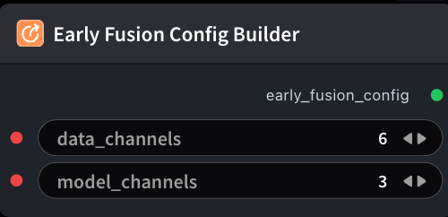

# Early Fusion Config Builder 节点



## 1.1 功能概述

构建 Early Fusion 配置 YAML（`data_channels = 3 × 视图数`），供 **YOLO Training** 使用。例如 2 视图→6，3 视图→9。接到 `ModelTrainYoloNode.early_fusion_config`；单图 3ch 训练可不接。

## 1.2 输入类型

| 参数 | 数据类型 | 必填 | 描述 |
|------|---------|------|------|
| data_channels | INT | 否 | 堆叠输入通道数（`3 × 视图数`，如双 RGB 为 6）。默认值：`6` |
| model_channels | INT | 否 | Early Fusion 后进入 YOLO 骨干的通道数（通常为 3）。默认值：`3` |

## 1.3 输出类型

| 参数 | 数据类型 | 描述 |
|------|---------|------|
| early_fusion_config | STRING | Early Fusion 配置 YAML |

## 1.4 Workflow JSON 定义

完整 workflow 定义见 [`workflow/EarlyFusionConfigBuilderNode/EarlyFusionConfigBuilderNode.json`](../../workflow/EarlyFusionConfigBuilderNode/EarlyFusionConfigBuilderNode.json)。

## 1.5 运行 Workflow

```bash
export PYROMIND_API_KEY=<your-api-key>
python -m pyromind_sdk.test_run_workflow_cli workflow/EarlyFusionConfigBuilderNode/EarlyFusionConfigBuilderNode.json [options]
```

| 选项 | 默认值 | 说明 |
|------|--------|------|
| `--name` | `earlyFusionConfigBuilderNode` | 任务名称 |
| `--output` | - | 输出结果文件 |
| `--poll-interval` | 5 | 轮询间隔（秒） |
| `--timeout` | 600 | 最大等待时间（秒） |
| `--pretty` | false | 美化 JSON 输出 |
| `--max-retries` | 0 | API 请求最大重试次数 |
| `-h, --help` | - | 显示帮助信息 |
