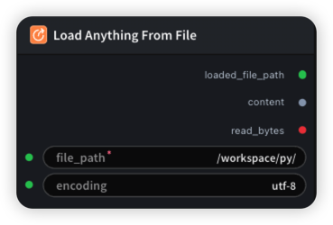

# Load Anything From File 节点



## 1.1 功能概述

读取工作区中指定路径的文本文件，输出文件内容、解析后的路径和字节数。
## 1.2 输入类型

| 参数 | 数据类型 | 必填 | 描述 |
|------|---------|------|------|
| file_path | STRING | 是 | 工作区中要读取的文件路径，支持绝对路径和相对路径。默认值：- |
| encoding | STRING | 否 | 读取文本文件时使用的编码格式。默认值：`utf-8` |
## 1.3 输出类型

| 参数 | 数据类型 | 描述 |
|------|---------|------|
| loaded_file_path | STRING | 加载文件在工作区中的解析后绝对路径。 |
| content | STRING | 从文件中读取的完整文本内容。 |
| read_bytes | INT | 按指定编码编码后的文件内容字节数。 |

## 1.4 Workflow JSON 定义

完整 workflow 定义见 [`workflow/LoadAnythingFromFile/LoadAnythingFromFile.json`](../../workflow/LoadAnythingFromFile/LoadAnythingFromFile.json)。

## 1.5 运行 Workflow

```bash
export PYROMIND_API_KEY=<your-api-key>
python -m pyromind_sdk.test_run_workflow_cli workflow/LoadAnythingFromFile/LoadAnythingFromFile.json [options]
```

| 选项 | 默认值 | 说明 |
|------|--------|------|
| `--name` | `loadAnythingFromFileNode` | 任务名称 |
| `--output` | - | 输出结果文件 |
| `--poll-interval` | 5 | 轮询间隔（秒） |
| `--timeout` | 600 | 最大等待时间（秒） |
| `--pretty` | false | 美化 JSON 输出 |
| `--max-retries` | 0 | API 请求最大重试次数 |
| `-h, --help` | - | 显示帮助信息 |

```bash
python -m pyromind_sdk.test_run_workflow_cli workflow/LoadAnythingFromFile/LoadAnythingFromFile.json --pretty
```

输出示例：

```json
{
  "task_id": "4874",
  "task_name": "unsaved-workflow",
  "status": "success",
  "error_message": null,
  "nodes": [
    {
      "node_key": "#1",
      "node_id": 18880,
      "node_type": "LoadAnythingFromFileNode",
      "label": "",
      "start_at": "2026-06-09 03:09:56",
      "end_at": "2026-06-09 03:10:10",
      "duration": "0:00:14",
      "input": {
        "file_path": "/workspace/py/example_valid_node.py",
        "encoding": "utf-8"
      },
      "output": {
        "loaded_file_path": "/workspace/py/example_valid_node.py",
        "content": "\"\"\"\n示例：符合验证规则的自定义节点\n- 基础类型: str, int, float, bool\n- 泛型类型: List[str], Optional[int]\n\"\"\"\n\nfrom typing import List, Optional\n\ndef process_data(a: int, b: int):\n    result = a + b\n    return {\"sum\": result, \"count\": 1, \"ok\": True}\n\n\ndef process_text(text: str, count: int) -> str:\n    \"\"\"处理文本并返回结果\"\"\"\n    return f\"Processed: {text} x {count}\"\n\n\ndef process_text_yaml(text1: str, text2: str, text3: str, count: int) -> str:\n    \"\"\"处理文本并返回结果\"\"\"\n    return f\"Processed: {text1} x {text2}x {text3} x {count}\"\n\ndef calculate_sum(numbers: List[int], scale: float) -> float:\n    \"\"\"计算列表总和并乘以缩放因子\"\"\"\n    total = sum(numbers)\n    return total * scale\n\n\ndef merge_strings(items: List[str], separator: str) -> str:\n    \"\"\"合并字符串列表\"\"\"\n    return separator.join(items)\n\n\ndef get_optional_value(name: str, default: Optional[str]) -> str:\n    \"\"\"获取可选值，如果为空则返回默认值\"\"\"\n    return name if name else (default or \"\")\n\n\ndef check_flag(enabled: bool, threshold: float) -> bool:\n    \"\"\"检查标志和阈值\"\"\"\n    return enabled and threshold > 0.5\n\n\nclass ExampleNode:\n    \"\"\"示例节点类\"\"\"\n    \n    def run(self, input_text: str, iterations: int) -> str:\n        \"\"\"执行节点逻辑\"\"\"\n        result = input_text * iterations\n        return result\n    \n    def process_batch(self, items: List[str]) -> List[str]:\n        \"\"\"批量处理\"\"\"\n        return [item.upper() for item in items]\n    \n    def calculate(self, values: List[float], multiplier: float) -> float:\n        \"\"\"计算加权值\"\"\"\n        return sum(values) * multiplier\n    \n    def check_status(self, is_active: bool, priority: int) -> bool:\n        \"\"\"检查状态\"\"\"\n        return is_active and priority > 0",
        "read_bytes": "1814"
      },
      "raw": {}
    }
  ]
}
```
