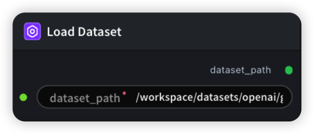

# LoadDataset 节点

  

## 2.1.1 功能概述

接收数据集路径，验证其可访问性，并透传路径。

- **路径解析**：接收用户指定的数据集路径输入
- **存在性验证**：通过 bash 命令检查数据集目录是否存在，确保路径有效
- **传递输出**：将验证后的数据集路径传递给下游节点，供训练流程使用

## 2.1.2 输入类型

| 参数         | 数据类型 | 描述                                                           |
| ------------ | -------- | -------------------------------------------------------------- |
| source_dir | PATH     | 需要加载的数据集文件或目录路径。默认值：`/workspace/datasets/openai/gsm8k` |

## 2.1.3 输出类型

| 参数         | 数据类型 | 描述                                                           |
| ------------ | -------- | -------------------------------------------------------------- |
| dataset_path | STRING   | 验证通过的数据集路径（与输入相同），供下游节点使用。若路径不存在则输出 `Dataset path not found` |

## 2.1.4 Workflow JSON 定义

完整 workflow 定义见 [`workflow/LoadDataset/LoadDataset.json`](../../workflow/LoadDataset/LoadDataset.json)。

## 2.1.5 运行 Workflow

```bash
python main.py workflow/LoadDataset/LoadDataset.json [options]
```

| 选项 | 默认值 | 说明 |
|------|--------|------|
| `--name` | `loadDatasetTest` | 任务名称 |
| `--output` | `tests/test_output/` | 输出结果文件 |
| `--poll-interval` | 5 | 轮询间隔（秒） |
| `--timeout` | 600 | 最大等待时间（秒） |
| `--pretty` | false | 美化 JSON 输出 |
| `--max-retries` | 0 | API 请求最大重试次数 |
| `-h, --help` | - | 显示帮助信息 |

```bash
python main.py workflow/LoadDataset/LoadDataset.json --pretty
```

输出示例：

```json
{
  "task_id": "4376",
  "task_name": "loadDatasetTest",
  "status": "success",
  "nodes": [
    {
      "node_name": "#1",
      "node_id": 17777,
      "start_at": "2026-06-04 05:44:25",
      "end_at": "2026-06-04 05:44:36",
      "duration": "0:00:11",
      "input": {
        "source_dir": "/workspace"
      },
      "output": {
        "dataset_path": "/workspace"
      }
    }
  ]
}
```
