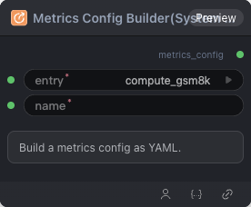

# Metrics Config Builder(System Entry) 节点



## 1.1 功能概述

构建系统内置 metrics 配置 YAML。

## 1.2 输入类型

| 参数 | 数据类型 | 必填 | 描述 |
|------|---------|------|------|
| entry | STRING | 是 | 默认值：`compute_gsm8k`。可选值：compute_gsm8k, compute_accuracy, compute_bleu, compute_rouge_l |
| name | STRING | 是 | 默认值：`''` |

## 1.3 输出类型

| 参数 | 数据类型 | 描述 |
|------|---------|------|
| metrics_config | STRING | 构建的 metrics 配置 YAML 字符串 |

## 1.4 Workflow JSON 定义

完整 workflow 定义见 [`workflow/MetricsConfigBuilderNode/MetricsConfigBuilderNode.json`](../../workflow/MetricsConfigBuilderNode/MetricsConfigBuilderNode.json)。

## 1.5 运行 Workflow

```bash
export PYROMIND_API_KEY=<your-api-key>
python -m pyromind_sdk.test_run_workflow_cli workflow/MetricsConfigBuilderNode/MetricsConfigBuilderNode.json [options]
```

| 选项 | 默认值 | 说明 |
|------|--------|------|
| `--name` | `metricsConfigBuilderNode` | 任务名称 |
| `--output` | - | 输出结果文件 |
| `--poll-interval` | 5 | 轮询间隔（秒） |
| `--timeout` | 600 | 最大等待时间（秒） |
| `--pretty` | false | 美化 JSON 输出 |
| `--max-retries` | 0 | API 请求最大重试次数 |
| `-h, --help` | - | 显示帮助信息 |
