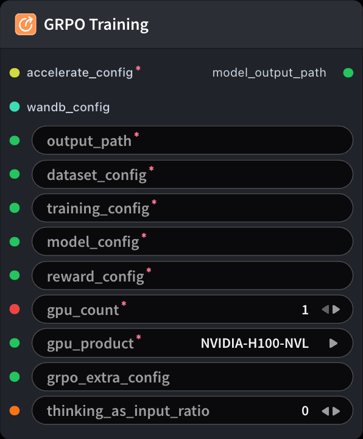

# GRPO Training 节点

  

## 1.1 功能概述

GRPO 的主训练节点，采用与 SFT 风格对齐的 YAML 配置：包含 dataset_config（数据集配置）、training_config（训练配置，与 SFT 共用）、grpo_extra_config（GRPO 专属配置）、model_config（模型配置）以及 reward_config（奖励配置）。该流程最终会返回训练好的模型目录。


## 1.2 输入类型

| 参数 | 数据类型 | 必填 | 描述                                    |
|------|---------|-----|----------------------------------------------------------------------------------------------------------------------------------------------------------------------------------------------------------------------------------------------------------------------------------------------------------------------------------------------------------------------------------------------------------------------------------------------------------------------------------------------------------------------------------------------------------|
| accelerate_config | STRING    | 是  | YAML mapping格式<br/><br/>参数示例：<br/> compute_environment: LOCAL_MACHINE<br/>debug: false <br/>deepspeed_config:<br/>&nbsp;&nbsp;&nbsp;&nbsp;zero3_init_flag: false<br/>&nbsp;&nbsp;&nbsp;&nbsp;zero_stage: 2<br/>distributed_type: DEEPSPEED<br/>enable_cpu_affinity: true<br/>machine_rank: 0<br/>main_training_function: main<br/>num_machines: 1<br/>num_processes: 2<br/>rdzv_backend: static<br/>same_network: true<br/>mixed_precision: bf16         |
| wandb_config | STRING    | 否 | wandb配置参数，YAML mapping格式<br/><br/>参数示例：<br/> WANDB_API_KEY: ********<br/>WANDB_PROJECT: [Your Project]<br/>WANDB_RUN_GROUP: [Your Group]                       |
| output_path | STRING | 是 | 模型输出地址                                       |
| dataset_config | STRING | 是 | 数据集配置，YAML mapping格式  <br/><br/>参数示例：<br/>train_data_path: [file path]dataloader_kind: vision<br/>image_field: image_path<br/>assistant_response_field: gt<br/>messages_field: messages<br/>sft_collator_entry: [file path]:[function name] exp: /workspace/test-workflow/collator.py:build_collate_fn<br/>grpo_collator_entry: [file path]:[function name] exp: /workspace/example/collator.py:create_grpo_collate_fn<br/>max_seq_length: 4096<br/>user_prompt_field: user_prompt<br/>system_prompt_field: system_prompt<br/>val_data_path: [file path] |
| training_config | STRING | 是 | 训练配置，YAML mapping格式  <br/><br/>参数示例：<br/>eval_steps: 100<br/>num_epochs: 0.0<br/>batch_size: 128<br/>grad_accum: 1<br/>learning_rate: 5.0e-05<br/>seed: 42<br/>max_grad_norm: 1.0<br/>lr_scheduler_type: constant<br/>                                         |
| model_config | STRING | 是 | 模型配置，YAML mapping格式  <br/><br/>参数示例：<br/>    model_name: [model path]<br/>model_type: auto<br/>lora_rank: 8<br/>full_finetune: false<br/>                                     |
| reward_config | STRING | 是 | 奖励配置，YAML mapping格式  <br/><br/>参数示例：<br/>normalize: false<br/>items:<br/>- entry: [file path]:[function name] exp: /workspace/example/reward.py:reward_json_parse<br/>&nbsp;&nbsp;&nbsp;&nbsp;source: python_path<br/>&nbsp;&nbsp;&nbsp;&nbsp;weight: 1.0<br/>&nbsp;&nbsp;&nbsp;&nbsp;factory: false<br/>&nbsp;&nbsp;&nbsp;&nbsp;kwargs: {}<br/>&nbsp;&nbsp;&nbsp;&nbsp;name: reward_json_parse<br/>- entry: [file path]:[function name] exp: /workspace/example/reward.py:reward_thinking_tags<br/>&nbsp;&nbsp;&nbsp;&nbsp;source: python_path<br/>&nbsp;&nbsp;&nbsp;&nbsp;weight: 1.0<br/>&nbsp;&nbsp;&nbsp;&nbsp;factory: false<br/>&nbsp;&nbsp;&nbsp;&nbsp;kwargs: {}<br/>&nbsp;&nbsp;&nbsp;&nbsp;name: reward_thinking_tags<br/>- entry: [file path]:[function name] exp: /workspace/example/reward.py:reward_task<br/>&nbsp;&nbsp;&nbsp;&nbsp;source: python_path<br/>&nbsp;&nbsp;&nbsp;&nbsp;weight: 1.0<br/>&nbsp;&nbsp;&nbsp;&nbsp;factory: false<br/>&nbsp;&nbsp;&nbsp;&nbsp;kwargs: {}<br/>&nbsp;&nbsp;&nbsp;&nbsp;name: reward_task<br/>- entry: [file path]:[function name] exp: /workspace/example/reward.py:make_reward_length<br/>&nbsp;&nbsp;&nbsp;&nbsp;source: python_path<br/>&nbsp;&nbsp;&nbsp;&nbsp;weight: 1.0<br/>&nbsp;&nbsp;&nbsp;&nbsp;factory: true<br/>&nbsp;&nbsp;&nbsp;&nbsp;kwargs:<br/>&nbsp;&nbsp;&nbsp;&nbsp;&nbsp;&nbsp;&nbsp;&nbsp;max_completion_length: 2048<br/>&nbsp;&nbsp;&nbsp;&nbsp;name: make_reward_length<br/>                                         |
| gpu_count | INT | 是 | 显卡个数，默认值：`1`                        |
| gpu_product | STRING | 是 | 显卡类型，默认值：`NVIDIA-H100-NVL` 可选参数: NVIDIA-H100-NVL, NVIDIA-L40S, NVIDIA-H200, NVIDIA-B200, NVIDIA-H100-80GB-HBM3                                        |
| grpo_extra_config | STRING | 否 | GRPO 专属配置，YAML mapping格式  <br/><br/>参数示例：<br/>max_steps: 500<br/>num_generations: 8<br/>max_prompt_length: 2048<br/>max_completion_length: 300<br/>temperature: 0.8<br/>enable_chord: true<br/>enable_hint: false<br/>                                     |
| thinking_as_input_ratio | FLOAT | 否 | 将思维链的内容作为输入的一部分，按比例采纳，默认值：`0.0`      |


## 1.3 输出类型

| 参数 | 数据类型 | 描述     |
|------|---------|--------|
| model_output_path | STRING | 模型输出地址 |

## 1.4 Workflow JSON 定义

完整 workflow 定义见 [`workflow/ModelTrainGRPONode/ModelTrainGRPONode.json`](/workflow/ModelTrainGRPONode/ModelTrainGRPONode.json)。

## 1.5 运行 Workflow

```bash
export PYROMIND_API_KEY=<your-api-key>
python -m pyromind_sdk.test_run_workflow_cli workflow/ModelTrainGRPONode/ModelTrainGRPONode.json [options]
```

| 选项 | 默认值 | 说明 |
|------|--------|------|
| `--name` | `modelTrainGRPONode` | 任务名称 |
| `--output` | - | 输出结果文件 |
| `--poll-interval` | 5 | 轮询间隔（秒） |
| `--timeout` | 600 | 最大等待时间（秒） |
| `--pretty` | false | 美化 JSON 输出 |
| `--max-retries` | 0 | API 请求最大重试次数 |
| `-h, --help` | - | 显示帮助信息 |
