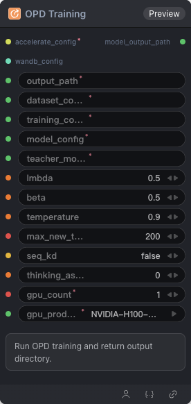

# OPD Training 节点



## 1.1 功能概述

运行 OPD（On-Policy Distillation）训练并返回模型输出目录。

## 1.2 输入类型

| 参数 | 数据类型 | 必填 | 描述 |
|------|---------|------|------|
| output_path | STRING | 是 | 输出目录路径 |
| dataset_config | STRING | 是 | 数据集配置 YAML 字符串 |
| training_config | STRING | 是 | 训练配置 YAML 字符串 |
| model_config | STRING | 是 | 模型配置 YAML 字符串 |
| teacher_model_config | STRING | 是 | 教师模型配置 YAML 字符串（OPD 用） |
| lmbda | FLOAT | 否 | OPD lmbda 超参数。默认值：`0.5` |
| beta | FLOAT | 否 | OPD beta 超参数。默认值：`0.5` |
| temperature | FLOAT | 否 | 采样温度。默认值：`0.9` |
| max_new_tokens | INT | 否 | 最大生成 token 数。默认值：`200` |
| seq_kd | BOOLEAN | 否 | 是否启用 sequence-level KD。默认值：`false` |
| thinking_as_input_ratio | FLOAT | 否 | 将思维链内容按比例作为输入的一部分。默认值：`0.0` |
| wandb_config | WANDB_CONFIG | 否 | W&B 配置 |

## 1.3 输出类型

| 参数 | 数据类型 | 描述 |
|------|---------|------|
| model_output_path | STRING | 模型输出目录路径 |

## 1.4 Workflow JSON 定义

完整 workflow 定义见 [`workflow/ModelTrainOPDNode/ModelTrainOPDNode.json`](../../workflow/ModelTrainOPDNode/ModelTrainOPDNode.json)。

## 1.5 运行 Workflow

```bash
export PYROMIND_API_KEY=<your-api-key>
python -m pyromind_sdk.test_run_workflow_cli workflow/ModelTrainOPDNode/ModelTrainOPDNode.json [options]
```

| 选项 | 默认值 | 说明 |
|------|--------|------|
| `--name` | `modelTrainOPDNode` | 任务名称 |
| `--output` | - | 输出结果文件 |
| `--poll-interval` | 5 | 轮询间隔（秒） |
| `--timeout` | 600 | 最大等待时间（秒） |
| `--pretty` | false | 美化 JSON 输出 |
| `--max-retries` | 0 | API 请求最大重试次数 |
| `-h, --help` | - | 显示帮助信息 |
