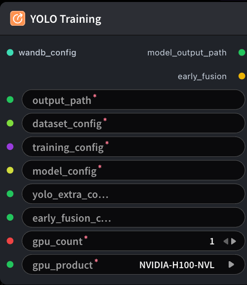

# YOLO 训练



## 1.1 功能概述

按 SFT/GRPO 相同的共享配置风格运行 YOLO（detect / segment / classify）训练：`dataset_config`、`training_config`、`model_config`。YOLO 专用参数来自 **YOLO Training Extra Config Builder**；多视图 Early Fusion（3N→3）请接 **Early Fusion Config Builder**，不接则为原生 3 通道单图训练。`train_data_path` 指向 `train.jsonl`（可选 `val_data_path`）；权重来自 `model_config.model_path`。

## 1.2 输入类型

| 参数 | 数据类型 | 必填 | 描述 |
|------|---------|------|------|
| dataset_config | STRING\|DATASET_CONFIG | 是 | 已组装的数据集配置 YAML 字符串 |
| training_config | STRING\|TRAINING_CONFIG | 是 | 训练配置 YAML 字符串（`BaseTrainingConfig` 字段） |
| model_config | STRING\|MODEL_CONFIG | 是 | 模型配置 YAML 字符串 |
| gpu_count | INT | 是 | 申请的 GPU 数量（1–8）。默认值：`1` |
| gpu_product | STRING | 是 | GPU 型号。此定义中的选项：`NVIDIA-H100-NVL`、`NVIDIA-L40S`。默认值：`NVIDIA-H100-NVL` |
| yolo_extra_config | STRING | 否 | YOLO 专用额外训练配置 YAML。默认值：空字符串 |
| wandb_config | WANDB_CONFIG | 否 | W&B 配置对象。默认值：空字符串 |
| early_fusion_config | STRING | 否 | Early Fusion 配置 YAML。默认值：空字符串 |

## 1.3 输出类型

| 参数 | 数据类型 | 描述 |
|------|---------|------|
| early_fusion | BOOLEAN | 本次训练是否启用了 Early Fusion |

## 1.4 Workflow JSON 定义

完整 workflow 定义见 [`workflow/ModelTrainYoloNode/ModelTrainYoloNode.json`](../../workflow/ModelTrainYoloNode/ModelTrainYoloNode.json)。

提交前，请将 `dataset_config`、`training_config` 和 `model_config` 配置为目标环境中的有效值，并选择该环境支持的 `gpu_count` 与 `gpu_product`。

## 1.5 运行 Workflow

```bash
export PYROMIND_API_KEY=<your-api-key>
python -m pyromind_sdk.test_run_workflow_cli workflow/ModelTrainYoloNode/ModelTrainYoloNode.json [options]
```

| 选项 | 默认值 | 说明 |
|------|--------|------|
| `--name` | `modelTrainYoloNode` | 任务名称 |
| `--output` | - | 输出结果文件 |
| `--poll-interval` | 5 | 轮询间隔（秒） |
| `--timeout` | 600 | 最大等待时间（秒） |
| `--pretty` | false | 美化 JSON 输出 |
| `--max-retries` | 0 | API 请求最大重试次数 |
| `-h, --help` | - | 显示帮助信息 |
