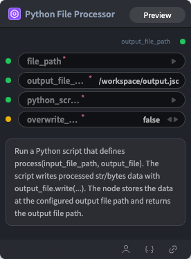

# Python File Processor 节点

## 1.1 功能概述

执行定义了 `process(input_file_path, output_file)` 的 Python 脚本。脚本向 `output_file` 写入文本或字节数据，节点返回生成文件的路径。

## 1.2 输入类型

| 参数 | 数据类型 | 必填 | 描述 |
|------|---------|------|
| file_path | STRING | 是 | 输入文件路径。 |
| output_file_path | STRING | 是 | 生成文件的输出路径。默认值：/workspace/output.json |
| python_script_path | STRING | 是 | Python 脚本路径；脚本必须定义 process(input_file_path, output_file)。 |
| overwrite_output | BOOLEAN | 是 | 是否允许覆盖已存在的输出文件。默认值：false |

## 1.3 输出类型

| 参数 | 数据类型 | 描述 |
|------|---------|------|
| output_file_path | STRING | Python 脚本写入完成后的文件路径。 |

## 1.4 Workflow JSON 定义

单节点 workflow 示例见 [workflow/PythonFileProcessorNode/PythonFileProcessorNode.json](../../workflow/PythonFileProcessorNode/PythonFileProcessorNode.json)。它读取 [sample_input.json](../../nodes/custom_py_script/sample_input.json)，并运行 [file_processor.py](../../nodes/custom_py_script/file_processor.py)，将 JSON 格式化后写入 `/workspace/output.json`。

运行 workflow 前，需将这两个文件分别放到执行环境中的 `/workspace/nodes/custom_py_script/sample_input.json` 和 `/workspace/nodes/custom_py_script/file_processor.py`。示例将 `overwrite_output` 设为 `true`，因此重复运行时可能覆盖 `/workspace/output.json`。部署方法见[自定义节点说明](../../nodes/README.md)。

## 1.5 运行 Workflow

按[仓库配置说明](../../README.md#setup)选择目标集群和 API 地址。

~~~bash
export PYROMIND_API_KEY=<your-api-key>
python -m pyromind_sdk.test_run_workflow_cli workflow/PythonFileProcessorNode/PythonFileProcessorNode.json --pretty
~~~
