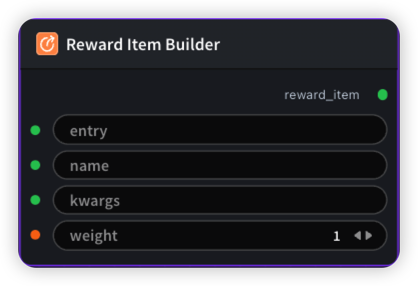

# Reward Item Builder(System Entry) 节点



## 1.1 功能概述

构建单个 reward item YAML（系统内置 entry）。非空 kwargs 表示 factory=true。

## 1.2 输入类型

| 参数 | 数据类型 | 必填 | 描述 |
|------|---------|------|------|
| entry | STRING | 是 | 默认值：`geometry_vqa_thinking_reward`。可选值：geometry_vqa_thinking_reward, geometry_vqa_answer_reward |
| name | STRING | 是 | 默认值：`''` |
| kwargs | STRING | 否 | 默认值：`''` |
| weight | FLOAT | 否 | 默认值：`1.0` |

## 1.3 输出类型

| 参数 | 数据类型 | 描述 |
|------|---------|------|
| reward_item | STRING | 构建的 reward item YAML 字符串 |

## 1.4 Workflow JSON 定义

完整 workflow 定义见 [`workflow/RewardItemBuilderNode/RewardItemBuilderNode.json`](../../workflow/RewardItemBuilderNode/RewardItemBuilderNode.json)。

## 1.5 运行 Workflow

```bash
export PYROMIND_API_KEY=<your-api-key>
python -m pyromind_sdk.test_run_workflow_cli workflow/RewardItemBuilderNode/RewardItemBuilderNode.json [options]
```

| 选项 | 默认值 | 说明 |
|------|--------|------|
| `--name` | `rewardItemBuilderNode` | 任务名称 |
| `--output` | - | 输出结果文件 |
| `--poll-interval` | 5 | 轮询间隔（秒） |
| `--timeout` | 600 | 最大等待时间（秒） |
| `--pretty` | false | 美化 JSON 输出 |
| `--max-retries` | 0 | API 请求最大重试次数 |
| `-h, --help` | - | 显示帮助信息 |

```bash
python -m pyromind_sdk.test_run_workflow_cli workflow/RewardItemBuilderNode/RewardItemBuilderNode.json --pretty
```

输出示例：

```json
{
  "task_id": "4878",
  "task_name": "rewarditembuildertest",
  "status": "success",
  "error_message": null,
  "nodes": [
    {
      "node_key": "#1",
      "node_id": 18888,
      "node_type": "RewardItemBuilderNode",
      "label": "",
      "start_at": "2026-06-09 03:25:37",
      "end_at": "2026-06-09 03:25:51",
      "duration": "0:00:14",
      "input": {
        "entry": "/workspace/py/example_valid_node.py",
        "name": "example_valid_node",
        "kwargs": "",
        "weight": 1
      },
      "output": {
        "reward_item": "entry: /workspace/py/example_valid_node.py\nsource: python_path\nweight: 1.0\nfactory: false\nkwargs: {}\nname: example_valid_node"
      },
      "raw": {}
    }
  ]
}
```
