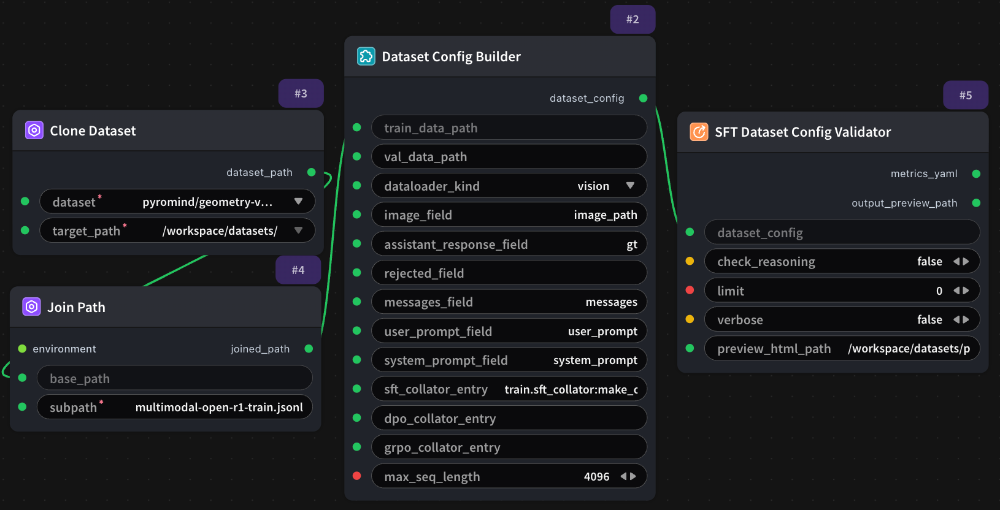

# Validate SFT Dataloader 节点



## 1.1 功能概述

验证`Dataset Config Builder`节点有效性，并生成数据预览HTML文件。（需配合其他节点一起使用）

## 1.2 输入类型

| 参数 | 数据类型 | 必填 | 描述 |
|------|---------|------|------|
| dataset_config | STRING | 是 | SFT 数据集配置路径或配置字符串。支持 JSON/YAML 格式，包含数据路径、格式、字段映射等配置信息。默认值：无 |
| check_reasoning | BOOLEAN | 否 | 是否检查数据集中的推理字段（如 `reasoning`）。启用后会验证推理链的完整性和一致性。默认值：`False` |
| limit | INT | 否 | 限制验证和预览的数据样本数量。|
| verbose | BOOLEAN | 否 | 是否输出详细的验证日志信息，包括每条数据的验证状态、警告和错误详情。默认值：`False` |
| preview_html_path | STRING | 否 | 生成的数据预览 HTML 报告的输出路径。仅支持绝对路径。默认值：`/workspace/datasets/preview.html` |

## 1.3 输出类型

| 参数 | 数据类型 | 描述 |
|------|---------|------|
| metrics_yaml | STRING | 验证指标结果的 YAML 格式字符串。包含数据质量评分、格式正确率、字段完整性、样本统计等详细指标。可保存为文件或传递给下游节点。 |
| output_preview_path | STRING | 实际生成的预览 HTML 文件的完整路径。如果输入参数 `preview_html_path` 是目录或未指定文件名，系统会自动生成文件名并返回实际路径。 |

## 1.4 Workflow JSON 定义

完整 workflow 定义见 [`workflow/SFTDatasetConfigValidatorNode/SFTDatasetConfigValidatorNode.json`](../../workflow/SFTDatasetConfigValidatorNode/SFTDatasetConfigValidatorNode.json)。

## 1.5 运行 Workflow

```bash
export PYROMIND_API_KEY=<your-api-key>
python -m pyromind_sdk.test_run_workflow_cli workflow/SFTDatasetConfigValidatorNode/SFTDatasetConfigValidatorNode.json [options]
```

| 选项 | 默认值 | 说明 |
|------|--------|------|
| `--name` | `SFTDatasetConfigValidatorNode` | 任务名称 |
| `--output` | - | 输出结果文件 |
| `--poll-interval` | 5 | 轮询间隔（秒） |
| `--timeout` | 600 | 最大等待时间（秒） |
| `--pretty` | false | 美化 JSON 输出 |
| `--max-retries` | 0 | API 请求最大重试次数 |
| `-h, --help` | - | 显示帮助信息 |

```bash
python -m pyromind_sdk.test_run_workflow_cli workflow/SFTDatasetConfigValidatorNode/SFTDatasetConfigValidatorNode.json --pretty
```

输出示例：

```json
{
  "task_id": "5082",
  "task_name": "unsaved-workflow",
  "status": "success",
  "error_message": null,
  "nodes": [
    {
      "node_key": "#5",
      "node_id": 19548,
      "node_type": "ModelSFTDatasetConfigValidatorNode",
      "label": "SFT Dataset Config Validator",
      "start_at": "2026-06-11 08:37:27",
      "end_at": "2026-06-11 08:38:27",
      "duration": "0:01:00",
      "input": {
        "dataset_config": "",
        "check_reasoning": false,
        "limit": 0,
        "verbose": false,
        "preview_html_path": "/workspace/datasets/preview.html"
      },
      "output": {
        "metrics_yaml": "dataloader_kind: vision\ntotal_rows: 1307\nvalidated_rows: 1307\nsample_keys:\n- __data_dir__\n- gt\n- id\n- image_path\n- images\n- system_prompt\n- user_prompt\nhas_image: true\nhas_text: true\nhas_messages: false\ncollator_loaded: true\nbatch_built: true\ncollator_output_type: tuple",
        "output_preview_path": "/workspace/datasets/preview.html"
      },
      "raw": {}
    },
    {
      "node_key": "#2",
      "node_id": 19547,
      "node_type": "DatasetConfigBuilderNode",
      "label": "Dataset Config Builder",
      "start_at": "2026-06-11 08:37:01",
      "end_at": "2026-06-11 08:37:21",
      "duration": "0:00:20",
      "input": {
        "train_data_path": "",
        "val_data_path": "",
        "dataloader_kind": "vision",
        "image_field": "image_path",
        "assistant_response_field": "gt",
        "rejected_field": "",
        "messages_field": "messages",
        "user_prompt_field": "user_prompt",
        "system_prompt_field": "system_prompt",
        "sft_collator_entry": "train.sft_collator:make_collate_fn",
        "dpo_collator_entry": "",
        "grpo_collator_entry": "",
        "max_seq_length": 4096
      },
      "output": {
        "dataset_config": "train_data_path: /workspace/datasets/pyromind/geometry-vqa-vlm-demo/multimodal-open-r1-train.jsonl\ndataloader_kind: vision\nimage_field: image_path\nassistant_response_field: gt\nrejected_field: ''\nmessages_field: messages\nsft_collator_entry: train.sft_collator:make_collate_fn\ndpo_collator_entry: ''\ngrpo_collator_entry: ''\nmax_seq_length: 4096\nuser_prompt_field: user_prompt\nsystem_prompt_field: system_prompt"
      },
      "raw": {}
    },
    {
      "node_key": "#4",
      "node_id": 19546,
      "node_type": "PathJoinNode",
      "label": "Join Path",
      "start_at": "2026-06-11 08:36:31",
      "end_at": "2026-06-11 08:36:49",
      "duration": "0:00:18",
      "input": {
        "base_path": "",
        "subpath": "multimodal-open-r1-train.jsonl",
        "environment": ""
      },
      "output": {
        "joined_path": "/workspace/datasets/pyromind/geometry-vqa-vlm-demo/multimodal-open-r1-train.jsonl"
      },
      "raw": {}
    },
    {
      "node_key": "#3",
      "node_id": 19545,
      "node_type": "CloneAndCacheDataset",
      "label": "Clone Dataset",
      "start_at": "2026-06-11 08:36:05",
      "end_at": "2026-06-11 08:36:24",
      "duration": "0:00:19",
      "input": {
        "dataset": "pyromind/geometry-vqa-vlm-demo",
        "target_path": "/workspace/datasets/"
      },
      "output": {
        "dataset_path": "/workspace/datasets/pyromind/geometry-vqa-vlm-demo"
      },
      "raw": {}
    }
  ]
}
```