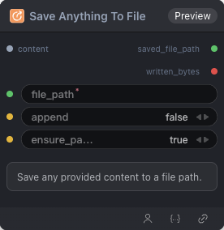

# Save Anything To File 节点

  

## 1.1 功能概述

Save any provided content to a file path.

## 1.2 输入类型

| 参数 | 数据类型 | 必填 | 描述                  |
|------|---------|----|---------------------|
| file_path | STRING | 是  | 文件路径。默认值：-          |
| append | BOOLEAN | 是  | 内容追加。默认值：`False`    |
| ensure_parent | BOOLEAN | 是  | 创建文件路径目录。默认值：`True` |
## 1.3 输出类型

| 参数 | 数据类型 | 描述 |
|------|---------|------|
| saved_file_path | STRING | 字符串 |
| written_bytes | INT | 整数 |

## 1.4 Workflow JSON 定义

完整 workflow 定义见 [`workflow/SaveAnythingToFile/SaveAnythingToFile.json`](../../workflow/SaveAnythingToFileNode/SaveAnythingToFileNode.json)。

## 1.5 运行 Workflow

```bash
export PYROMIND_API_KEY=<your-api-key>
python -m pyromind_sdk.test_run_workflow_cli workflow/SaveAnythingToFile/SaveAnythingToFile.json --pretty
```

| 选项 | 默认值 | 说明 |
|------|--------|------|
| `--name` | `saveAnythingToFileNode` | 任务名称 |
| `--output` | - | 输出结果文件 |
| `--poll-interval` | 5 | 轮询间隔（秒） |
| `--timeout` | 600 | 最大等待时间（秒） |
| `--pretty` | false | 美化 JSON 输出 |
| `--max-retries` | 0 | API 请求最大重试次数 |
| `-h, --help` | - | 显示帮助信息 |


输出示例：

```json
{
  "task_id": "4818",
  "task_name": "unsaved-workflow",
  "status": "success",
  "error_message": null,
  "nodes": [
    {
      "node_key": "#1",
      "node_id": 18673,
      "node_type": "SaveAnythingToFileNode",
      "label": "",
      "start_at": "2026-06-08 11:51:59",
      "end_at": "2026-06-08 11:52:24",
      "duration": "0:00:25",
      "input": {
        "file_path": "/workspace/py/test.py",
        "content": "",
        "append": true,
        "ensure_parent": true
      },
      "output": {
        "saved_file_path": "/workspace/py/test.py",
        "written_bytes": "32"
      },
      "raw": {}
    },
    {
      "node_key": "#2",
      "node_id": 18672,
      "node_type": "LoadDataset",
      "label": "",
      "start_at": "2026-06-08 11:51:28",
      "end_at": "2026-06-08 11:51:49",
      "duration": "0:00:21",
      "input": {
        "source_dir": "/workspace/datasets/openai/gsm8k"
      },
      "output": {
        "dataset_path": "/workspace/datasets/openai/gsm8k"
      },
      "raw": {}
    }
  ]
}


```