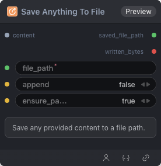

# Save Anything To File 节点

  

## {{section}} 功能概述

Save any provided content to a file path.

## {{section}} 输入类型

| 参数 | 数据类型 | 必填 | 描述 |
|------|---------|------|------|
| file_path | STRING | 是 | 字符串。默认值：- |
| content | * | 否 | 任意类型。默认值：- |
| append | BOOLEAN | 否 | 布尔值。默认值：`False` |
| ensure_parent | BOOLEAN | 否 | 布尔值。默认值：`True` |
## {{section}} 输出类型

| 参数 | 数据类型 | 描述 |
|------|---------|------|
| saved_file_path | STRING | 字符串 |
| written_bytes | INT | 整数 |

## {{section}} Workflow JSON 定义

完整 workflow 定义见 [`workflow/SaveAnythingToFileNode/SaveAnythingToFileNode.json`](../../workflow/SaveAnythingToFileNode/SaveAnythingToFileNode.json)。

## {{section}} 运行 Workflow

```bash
export PYROMIND_API_KEY=<your-api-key>
python -m pyromind_sdk.test_run_workflow_cli workflow/SaveAnythingToFileNode/SaveAnythingToFileNode.json [options]
```

| 选项 | 默认值 | 说明 |
|------|--------|------|
| `--name` | `saveAnythingToFileNode` | 任务名称 |
| `--output` | - | 输出结果文件 |
| `--poll-interval` | 5 | 轮询间隔（秒） |
| `--timeout` | 600 | 最大等待时间（秒） |
| `--pretty` | false | 美化 JSON 输出 |
| `--max-retries` | 0 | API 请求最大重试次数 |
| `-h, --help` | - | 显示帮助信息 |
