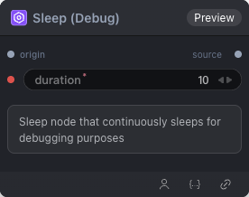

# Sleep (Debug) 节点

  

## {{section}} 功能概述

Sleep 节点：持续睡眠用于调试

## {{section}} 输入类型

| 参数 | 数据类型 | 必填 | 描述 |
|------|---------|------|------|
| duration | INT | 是 | 整数。默认值：`10` |
| interval | INT | 是 | 整数。默认值：`2` |
## {{section}} 输出类型

| 参数 | 数据类型 | 描述 |
|------|---------|------|
| status | STRING | 字符串 |

## {{section}} Workflow JSON 定义

完整 workflow 定义见 [`workflow/SleepNode/SleepNode.json`](../../workflow/SleepNode/SleepNode.json)。

## {{section}} 运行 Workflow

```bash
export PYROMIND_API_KEY=<your-api-key>
python -m pyromind_sdk.test_run_workflow_cli workflow/SleepNode/SleepNode.json [options]
```

| 选项 | 默认值 | 说明 |
|------|--------|------|
| `--name` | `sleepNode` | 任务名称 |
| `--output` | - | 输出结果文件 |
| `--poll-interval` | 5 | 轮询间隔（秒） |
| `--timeout` | 600 | 最大等待时间（秒） |
| `--pretty` | false | 美化 JSON 输出 |
| `--max-retries` | 0 | API 请求最大重试次数 |
| `-h, --help` | - | 显示帮助信息 |
