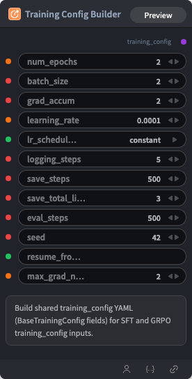

# Training Config Builder 节点



## 1.1 功能概述

构建 SFT/GRPO/DPO 共用的 training_config YAML 字符串（BaseTrainingConfig 字段）。

## 1.2 输入类型

| 参数 | 数据类型 | 必填 | 描述 |
|------|---------|------|------|
| num_epochs | FLOAT | 否 | 默认值：`2` |
| batch_size | INT | 否 | 默认值：`2` |
| grad_accum | INT | 否 | 默认值：`2` |
| learning_rate | FLOAT | 否 | 默认值：`0.0001` |
| lr_scheduler_type | STRING | 否 | 默认值：`constant`。可选值：linear, cosine, cosine_with_restarts, polynomial, constant, constant_with_warmup |
| logging_steps | INT | 否 | 默认值：`5` |
| save_steps | INT | 否 | 默认值：`500` |
| save_total_limit | INT | 否 | 默认值：`3` |
| eval_steps | INT | 否 | 默认值：`500` |
| seed | INT | 否 | 默认值：`42` |
| resume_from_checkpoint | STRING | 否 | 默认值：`''` |
| max_grad_norm | FLOAT | 否 | 默认值：`2` |

## 1.3 输出类型

| 参数 | 数据类型 | 描述 |
|------|---------|------|
| training_config | STRING | 构建的训练配置 YAML 字符串 |

## 1.4 Workflow JSON 定义

完整 workflow 定义见 [`workflow/TrainingConfigBuilderNode/TrainingConfigBuilderNode.json`](../../workflow/TrainingConfigBuilderNode/TrainingConfigBuilderNode.json)。

## 1.5 运行 Workflow

```bash
export PYROMIND_API_KEY=<your-api-key>
python -m pyromind_sdk.test_run_workflow_cli workflow/TrainingConfigBuilderNode/TrainingConfigBuilderNode.json [options]
```

| 选项 | 默认值 | 说明 |
|------|--------|------|
| `--name` | `trainingConfigBuilderNode` | 任务名称 |
| `--output` | - | 输出结果文件 |
| `--poll-interval` | 5 | 轮询间隔（秒） |
| `--timeout` | 600 | 最大等待时间（秒） |
| `--pretty` | false | 美化 JSON 输出 |
| `--max-retries` | 0 | API 请求最大重试次数 |
| `-h, --help` | - | 显示帮助信息 |
