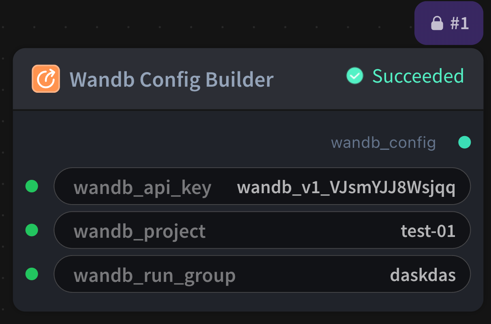

# Wandb Config Builder 节点



## 1.1 功能概述

构建 W&B (Weights & Biases) 训练运行时环境的 `wandb_config` YAML 字符串。该节点用于配置 W&B 实验追踪参数，便于在训练过程中记录和可视化实验指标。

## 1.2 输入类型

| 参数 | 数据类型 | 必填 | 描述 |
|------|---------|------|------|
| wandb_api_key | STRING | 否 | W&B API 密钥，用于身份验证。默认值：空字符串 |
| wandb_project | STRING | 否 | W&B 项目名称，用于组织实验。默认值：空字符串 |
| wandb_run_group | STRING | 否 | W&B 运行组名称，用于分组相关实验。默认值：空字符串 |

## 1.3 输出类型

| 参数 | 数据类型   | 描述 |
|------|--------|------|
| wandb_config | STRING | 构建的 W&B 配置对象，供下游训练节点使用 |

## 1.4 Workflow JSON 定义

完整 workflow 定义见 [`workflow/WandbConfigBuilderNode/WandbConfigBuilderNode.json`](../../workflow/WandbConfigBuilderNode/WandbConfigBuilderNode.json)。

示例配置：
```json
{
  "config": {
    "wandb_api_key": "",
    "wandb_project": "test-01",
    "wandb_run_group": "daskdas"
  }
}
```

## 1.5 运行 Workflow

```bash
export PYROMIND_API_KEY=<your-api-key>
python -m pyromind_sdk.test_run_workflow_cli workflow/WandbConfigBuilderNode/WandbConfigBuilderNode.json [options]
```

| 选项 | 默认值 | 说明 |
|------|--------|------|
| `--name` | `WandbConfigBuilderNode` | 任务名称 |
| `--output` | - | 输出结果文件 |
| `--poll-interval` | 5 | 轮询间隔（秒） |
| `--timeout` | 600 | 最大等待时间（秒） |
| `--pretty` | false | 美化 JSON 输出 |
| `--max-retries` | 0 | API 请求最大重试次数 |
| `-h, --help` | - | 显示帮助信息 |

```bash
python -m pyromind_sdk.test_run_workflow_cli workflow/WandbConfigBuilderNode/WandbConfigBuilderNode.json --pretty
```

输出示例：

```json
{
  "task_id": "4922",
  "task_name": "wandb",
  "status": "success",
  "error_message": null,
  "nodes": [
    {
      "node_key": "#1",
      "node_id": 18988,
      "node_type": "WandbConfigBuilderNode",
      "label": "",
      "start_at": "2026-06-09 09:33:15",
      "end_at": "2026-06-09 09:33:32",
      "duration": "0:00:17",
      "input": {
        "wandb_api_key": "",
        "wandb_project": "test-01",
        "wandb_run_group": "daskdas"
      },
      "output": {
        "wandb_config": "WANDB_PROJECT: test-01\nWANDB_RUN_GROUP: daskdas"
      },
      "raw": {}
    }
  ]
}
```
