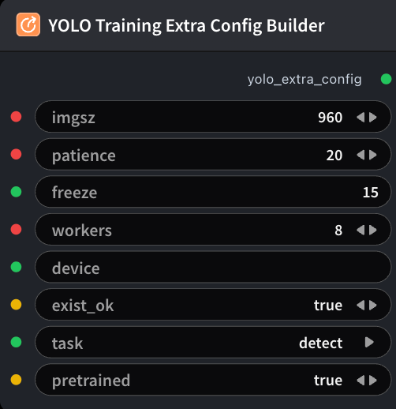

# YOLO Training Extra Config Builder 节点



## 1.1 功能概述

构建 `yolo_extra_config` YAML（imgsz、patience、freeze、task 等），供 **YOLO Training** 使用，对标 GRPO Training Extra Config。本节点不设置权重；请用 Download/Clone Model → Model Config Builder 接到 `ModelTrainYoloNode.model_config`。

## 1.2 输入类型

| 参数 | 数据类型 | 必填 | 描述 |
|------|---------|------|------|
| imgsz | INT | 否 | 训练 / 推理图像边长。默认值：`960` |
| patience | INT | 否 | Early-stop 耐心 epoch 数（0 表示关闭）。默认值：`20` |
| freeze | STRING | 否 | 冻结骨干前 N 层（整数字符串，或逗号分隔层索引）。默认值：`15` |
| workers | INT | 否 | DataLoader worker 数。默认值：`8` |
| exist_ok | BOOLEAN | 否 | 若训练运行目录已存在，是否允许复用。默认值：true |
| task | STRING | 否 | YOLO 任务类型。选项：`detect`, `segment`, `classify` |
| pretrained | BOOLEAN | 否 | 是否用 `model_config.model_path` 的预训练权重初始化。默认值：true |

## 1.3 输出类型

| 参数 | 数据类型 | 描述 |
|------|---------|------|
| yolo_extra_config | STRING | YOLO 专用额外训练配置 YAML |

## 1.4 Workflow JSON 定义

完整 workflow 定义见 [`workflow/YoloTrainingExtraConfigBuilderNode/YoloTrainingExtraConfigBuilderNode.json`](../../workflow/YoloTrainingExtraConfigBuilderNode/YoloTrainingExtraConfigBuilderNode.json)。

## 1.5 运行 Workflow

```bash
export PYROMIND_API_KEY=<your-api-key>
python -m pyromind_sdk.test_run_workflow_cli workflow/YoloTrainingExtraConfigBuilderNode/YoloTrainingExtraConfigBuilderNode.json [options]
```

| 选项 | 默认值 | 说明 |
|------|--------|------|
| `--name` | `yoloTrainingExtraConfigBuilderNode` | 任务名称 |
| `--output` | - | 输出结果文件 |
| `--poll-interval` | 5 | 轮询间隔（秒） |
| `--timeout` | 600 | 最大等待时间（秒） |
| `--pretty` | false | 美化 JSON 输出 |
| `--max-retries` | 0 | API 请求最大重试次数 |
| `-h, --help` | - | 显示帮助信息 |
